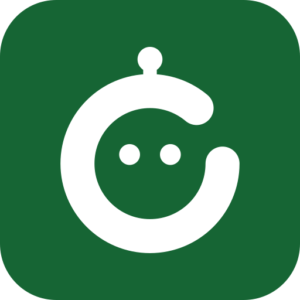
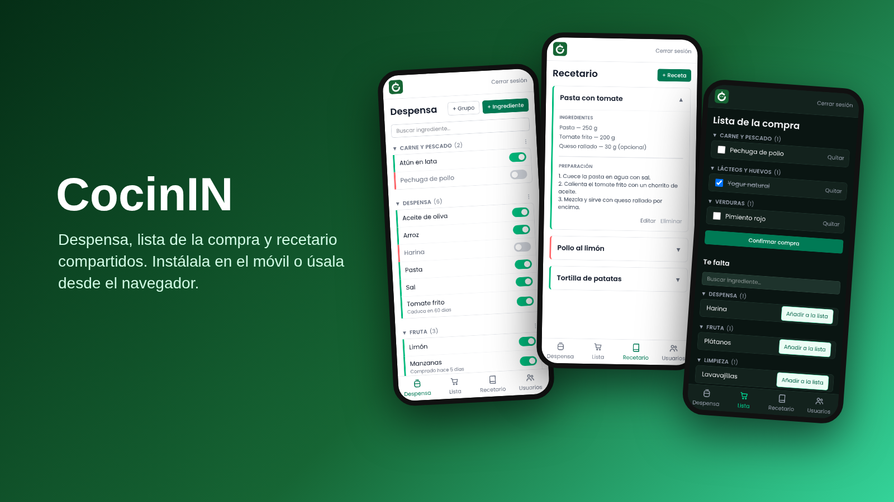
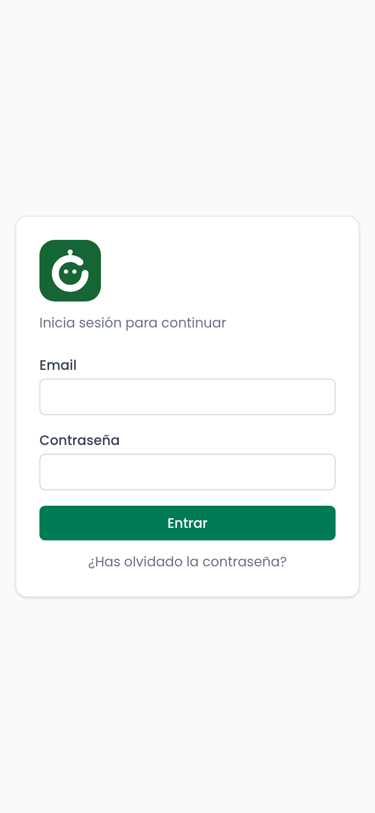
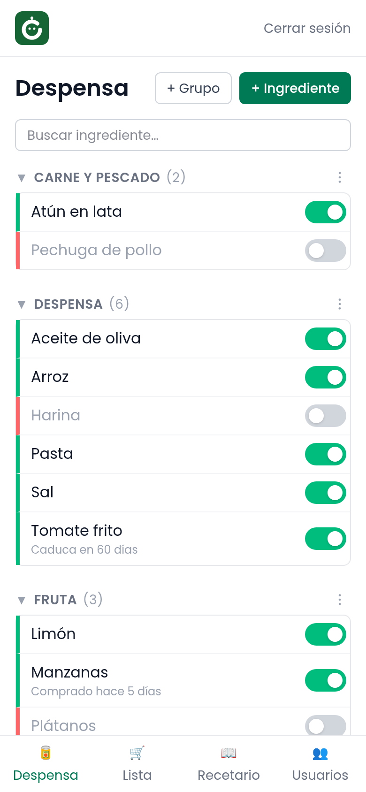
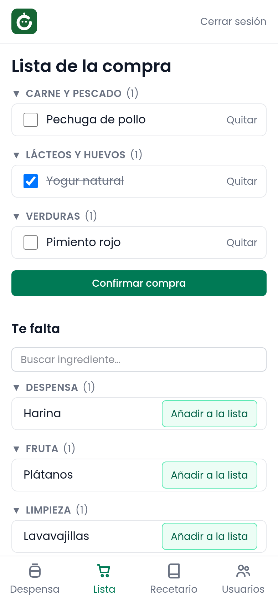
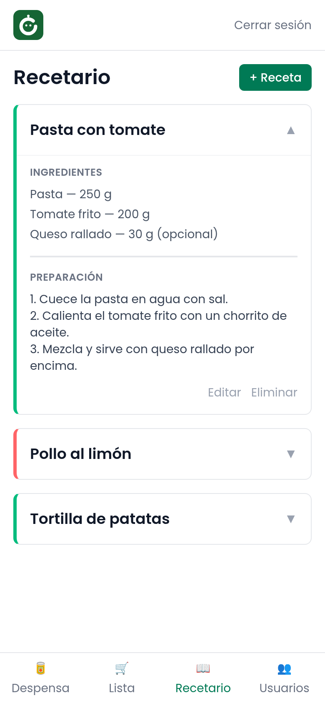

<p align="center">
  
</p>

<h1 align="center">CocinIN</h1>

<p align="center">
  Despensa, lista de la compra y recetario compartidos para toda la casa.<br>
  Se instala como app en el móvil y también funciona desde cualquier navegador.
</p>

<p align="center">
  
</p>

## ¿Qué es?

CocinIN responde a tres preguntas del día a día: **¿qué tenemos en casa?**, **¿qué hay que comprar?** y **¿qué podemos cocinar?** Todo se sincroniza al instante entre las personas de la casa: si alguien tacha algo en el súper, los demás lo ven en su móvil.

- 🥫 **Despensa**: ingredientes por grupos con un interruptor *disponible / agotado*, un copo de nieve para marcarlos como *congelados*, y fecha de compra o de caducidad (con avisos de «caduca en 2 días»).
- 🛒 **Lista de la compra**: lo que te falta, con buscador. Al confirmar la compra, lo comprado vuelve a la despensa y se anota en el historial.
- 📖 **Recetario**: recetas con ingredientes (obligatorios u opcionales) y preparación. Cada receta se marca según tengas o no lo necesario.
- 👥 **Usuarios**: un administrador da de alta a los demás. Cada casa tiene su propia instalación y sus datos son privados.
- 🌗 Modo claro y oscuro automático, y copia de seguridad en un clic.

Es una **PWA**: puedes usarla desde el navegador del ordenador o del móvil, o **instalarla como una app** con su icono en la pantalla de inicio, a pantalla completa y sin barra del navegador.

### Instalarla como app

| Dispositivo | Cómo |
| --- | --- |
| Android (Chrome) | Menú ⋮ → **Instalar aplicación** (o *Añadir a la pantalla de inicio*). |
| iPhone / iPad (Safari) | Botón Compartir → **Añadir a pantalla de inicio**. |
| Ordenador (Chrome, Edge) | Icono de instalar en la barra de direcciones. |

## Capturas

<p>
  
  
  
  
</p>

*Los datos de las capturas son de ejemplo.*

Tecnología: React 19 + TypeScript + Vite + Tailwind, y Firebase (Authentication, Firestore y Hosting).

---

## Requisitos

Necesitas **Node.js 20 o superior**, una **cuenta de Google** y, para descargar el código, **Git** (o el botón *Code → Download ZIP* de GitHub). No hace falta tarjeta: todo cabe en el plan gratuito de Firebase (Spark) para uso doméstico.

**Windows** (PowerShell o Terminal; basta con abrirla desde el menú Inicio):

```powershell
winget install OpenJS.NodeJS.LTS
winget install Git.Git
```

Cierra y vuelve a abrir la terminal después de instalar. Si no tienes `winget`, descarga los instaladores de <https://nodejs.org> y <https://git-scm.com>.

**macOS**: `brew install node git`. **Linux**: instala `nodejs` (v20+), `npm` y `git` con el gestor de tu distribución.

Comprueba que funciona: `node --version` debe mostrar v20 o superior.

---

## Instalación rápida (recomendada)

Los comandos son idénticos en Windows (PowerShell), macOS y Linux:

```sh
git clone https://github.com/nithreel/cocinin.git
cd cocinin
npm install
npm run setup
```

El asistente (`scripts/setup.mjs`) hace todo esto, pidiéndote solo lo imprescindible:

1. Abre el navegador para iniciar sesión en Firebase con tu cuenta de Google.
2. Te pide un **id de proyecto** y lo crea (o reutiliza uno tuyo). Ese id **es tu dirección**: `https://<id>.web.app`.
   Debe ser único en todo Firebase; si está cogido te pide otro (por ejemplo `cocinin-maria`).
3. Registra la app web y escribe `.env` y `.firebaserc` con tu configuración.
4. Activa Firestore (región `eur3`, Europa).
5. Te guía en el único paso manual: pulsar **Comenzar** y habilitar *Correo electrónico/contraseña* en Authentication (1 minuto; la API para hacerlo solo existe en el plan de pago).
6. Compila y despliega las reglas de seguridad y la web.

Al terminar, abre tu URL. Mientras no exista ningún usuario, la pantalla de login muestra **Crear usuario**: el primero que se crea es el **administrador**.

> ⚠️ **Crea tu usuario nada más desplegar.** Hasta que exista el primero, cualquiera que conozca la URL podría registrarse como administrador. Con el primer usuario creado, esa puerta se cierra para siempre.

> Si crear la base de datos falla, el asistente te da el enlace exacto de la consola y espera a que lo hagas.

---

## Instalación manual (paso a paso)

Si prefieres no usar el asistente:

1. **Crea el proyecto** en <https://console.firebase.google.com> → *Add project*. El id que elijas será tu URL (`<id>.web.app`).
2. **Authentication** → *Get started* → *Sign-in method* → activa **Email/Password**.
3. **Firestore Database** → *Create database* → modo producción → región europea.
4. **Registra la app web**: Configuración del proyecto (rueda dentada) → *Your apps* → icono `</>`. Copia los valores de `firebaseConfig`.
5. **Configura el código** (copiando las plantillas):

   | | Windows (PowerShell) | macOS / Linux |
   | --- | --- | --- |
   | Dependencias | `npm install` | `npm install` |
   | Variables | `copy .env.example .env` | `cp .env.example .env` |
   | Proyecto | `copy .firebaserc.example .firebaserc` | `cp .firebaserc.example .firebaserc` |

   Edita `.env` con los valores de `firebaseConfig` y `.firebaserc` con el id de tu proyecto.
6. **Despliega**:
   ```sh
   npx firebase login
   npm run deploy                     # compila y sube reglas + web
   ```
7. Abre `https://<id>.web.app` y crea **enseguida** el primer usuario (administrador): hasta entonces cualquiera con la URL podría hacerlo.

---

## Uso diario

| Acción | Cómo |
| --- | --- |
| Añadir ingrediente | Despensa → «+ Ingrediente». Nace disponible (ON) y la lista te lleva hasta él. |
| Marcar agotado/disponible | Interruptor a la derecha del ingrediente. |
| Marcar como congelado | Copo de nieve junto al interruptor: la barra y el interruptor se ponen azules. Un ingrediente congelado cuenta como disponible. |
| Fecha de compra o caducidad, cantidad que queda, editar o eliminar un ingrediente | Toca el ingrediente: se abre un panel con las fechas y la cantidad (si está en ON) y los botones **Editar** y **Eliminar**. La cantidad es texto libre (p. ej. «500 g»), empieza vacía y se borra al marcarlo agotado. |
| Buscar | El buscador de la Despensa filtra por nombre de ingrediente **o de grupo** («Curry» enseña también todo el grupo Curry). |
| Comprar | Lista → «Añadir a la lista» en lo que falta (con buscador) → marca lo comprado → «Confirmar compra». |
| Receta nueva | Recetario → «+ Receta»; hay buscador de ingredientes. |
| Dar de alta o quitar usuarios, o exportar copia | Menú **Usuarios** (solo administrador). |
| Olvidé la contraseña | Login → «¿Has olvidado la contraseña?» (llega un correo de Firebase). |

---

## Usuarios y seguridad

- Un usuario es **miembro** si existe el documento `users/{uid}` en Firestore. Las reglas (`firestore.rules`) solo permiten leer y escribir datos a los miembros. No hay UIDs ni correos escritos en el código.
- El campo `role` del usuario es `admin` (el primero creado) o `member`. **Solo el admin** crea usuarios y quita accesos, y no puede quitarse a sí mismo.
- `meta/setup` marca que la instalación ya está hecha: solo mientras no exista se permite crear el primer usuario, y se crea a la vez que su documento.
- «Quitar acceso» bloquea al usuario en la app; su cuenta de Authentication sigue existiendo y puede borrarse en la consola de Firebase.
- La configuración web de Firebase (`VITE_FIREBASE_*`) **no es secreta**: viaja en el JavaScript público, y la protección real son las reglas de Firestore. Aun así `.env` está fuera del control de versiones; no lo subas.
- **Un proyecto de Firebase por instalación.** No compartas el mismo proyecto entre casas distintas: se mezclarían los datos. Cada una tiene su propio id y su propia URL.

---

## Actualizar Cocinin a una versión nueva

Cuando haya cambios en este repositorio, tu copia no se actualiza sola. Desde la carpeta `cocinin` (mismos comandos en Windows, macOS y Linux):

```sh
git pull
npm install
npm run deploy
```

1. `git pull` baja el código nuevo. Tu `.env` y `.firebaserc` no se tocan (no están en el repositorio), así que seguirás conectado a tu proyecto y con tus datos.
2. `npm install` instala las dependencias nuevas, si las hay.
3. `npm run deploy` compila y publica la web y las reglas de seguridad en tu Firebase.

Después, la app instalada puede enseñar la versión anterior hasta que la cierres y abras una o dos veces (en el navegador, `Ctrl+Shift+R`). Tus datos no se pierden: los campos nuevos aparecen vacíos y se rellenan cuando quieras.

Si `git pull` se queja de cambios locales, es que has editado archivos del repositorio: guárdalos con `git stash`, haz el `pull` y recupéralos con `git stash pop`. Si has iniciado sesión en otra cuenta o ordenador, repite antes `npx firebase login`.

---

## Mantenimiento

- **Actualizar** tras cambiar el código: `npm run deploy`. Solo las reglas: `npm run deploy:rules`.
- **Sin conexión**: la app guarda una copia local de los datos y se abre con ellos aunque no haya cobertura; los cambios se sincronizan al volver la conexión.
- **Rutas nuevas**: si añades una ruta en `src/App.tsx`, añade también su `no-cache` en `firebase.json` (lo comprueba `npm test`); si no, la app instalada tardaría hasta 1 h en ver las novedades.
- **PWA**: tras un despliegue, la app instalada puede mostrar la versión anterior hasta cerrarla y abrirla una o dos veces (o recarga forzada `Ctrl+Shift+R` en el navegador).
- **Dominio propio**: Firebase Console → Hosting → *Add custom domain*.
- **Copia de seguridad**: el administrador puede descargar un JSON con todos los datos desde **Usuarios → Exportar copia**. Hazlo de vez en cuando.
- **Límites del plan gratuito** (Spark): 1 GiB de datos, 50 000 lecturas y 20 000 escrituras al día en Firestore, y 10 GB de almacenamiento en Hosting. Más que suficiente para una casa.

---

## Problemas frecuentes

| Síntoma | Causa y solución |
| --- | --- |
| La web dice «Falta la configuración de Firebase» | No existe `.env` o está vacío. Ejecuta `npm run setup` o copia `.env.example` y rellénalo, y vuelve a compilar. |
| El login dice que activa el acceso por correo | Authentication → Sign-in method → Email/Password sin habilitar. |
| «Las reglas de Firestore no están desplegadas» o 403 | Ejecuta `npm run deploy:rules`. |
| «Tu cuenta no tiene acceso a esta cocina» | La cuenta existe pero no figura en `users`. Que el admin la dé de alta desde **Usuarios**. |
| El id de proyecto se rechaza | Los ids son únicos en todo Firebase; prueba otro. |
| `firebase: command not found` | Usa `npx firebase …` (viene como dependencia del proyecto). |
| En Windows: «la ejecución de scripts está deshabilitada» | Abre PowerShell y ejecuta una vez `Set-ExecutionPolicy -Scope CurrentUser RemoteSigned`, o usa el *Símbolo del sistema* (cmd). |
| `node` o `git` no se reconocen | Cierra y vuelve a abrir la terminal tras instalarlos. |
| No veo los cambios tras desplegar | Caché de la PWA: cierra y abre la app, o `Ctrl+Shift+R`. |

---

## Desarrollo

```sh
npm run dev      # servidor local con recarga (usa tu .env, es decir, tus datos reales)
npm run lint     # oxlint
npm run build    # tsc + vite build
npm test         # pruebas unitarias (caducidades, agrupación)
npm run test:rules  # pruebas de las reglas de seguridad (emulador, Java 21+)
```

Cada `push` y cada pull request pasan por GitHub Actions (`.github/workflows/ci.yml`): lint, compilación y las dos baterías de pruebas.

Para desarrollar **sin tocar datos reales** puedes usar los emuladores de Firebase (necesitan Java 21+; en Windows: `winget install EclipseAdoptium.Temurin.21.JDK`):

```sh
npm run emulators                              # Auth :9099 y Firestore :8089, en otra terminal
```

Y en otra terminal, arranca la app apuntando a ellos:

```sh
# macOS / Linux
VITE_USE_EMULATORS=true npm run dev

# Windows (PowerShell)
$env:VITE_USE_EMULATORS="true"; npm run dev
```

Los emuladores empiezan vacíos: en el login aparecerá «Crear usuario» para crear el administrador local.

Estructura:

```
src/auth/            login, sesión y rutas protegidas (roles admin / member)
src/features/        pantry (despensa), shopping-list, recipes, users
src/lib/             tipos y colecciones de Firestore, datos en vivo, caducidades
src/components/      layout y piezas comunes (menús, buscador, borrado con confirmación)
tests/               unit/ (lógica pura) y rules/ (reglas de Firestore con emulador)
scripts/setup.mjs    asistente de instalación (npm run setup)
firestore.rules      reglas de acceso
```

## Licencia

MIT. Ver `LICENSE`.

## Avisos push (opcional)

La app funciona completa sin esto. Si quieres que el móvil reciba notificaciones, hace falta un servicio pequeño que las envíe. Firebase gratis no puede (necesitaría Cloud Functions, que exige el plan Blaze de pago), así que el envío lo hace `notifier/`, que corre en una máquina tuya siempre encendida. Coste: 0 €.

**Avisos que envía**

| Aviso | Cuándo |
|---|---|
| Elemento gastado | un ingrediente de la despensa pasa a agotado (agrupa los que llegan seguidos, 60 s) |
| Lista de la compra | se añaden varios elementos (uno solo no avisa; un aviso por tanda, con 15 min de enfriamiento) |
| Compra hecha | se confirma la compra |
| Receta nueva | entra una receta en el recetario |
| Usuario nuevo | el admin añade a alguien |
| Caducidad | un ingrediente entra en «caduca en 3 días o menos» (revisión cada hora, solo de 8:00 a 22:00) |

No se avisa a quien provoca el cambio, y cada persona activa o quita cada tipo en la pantalla **Avisos** (campana de la cabecera).

**Qué necesitas**
- Una máquina siempre encendida con **Docker** y conexión a internet (consume poca memoria; funciona en una Raspberry Pi 3). No hace falta que esté en tu red local ni abrir puertos: solo habla hacia fuera con Firestore y con los servidores de push.
- La **clave de la cuenta de servicio** de tu proyecto Firebase: consola de Firebase → Configuración del proyecto → Cuentas de servicio → *Generar nueva clave privada*. Guárdala como `notifier/secrets/service-account.json`. Da acceso amplio al proyecto: no la subas a git (la carpeta `secrets/` ya está ignorada), no la compartas y déjala solo en esa máquina.
- Node y `npm` en el ordenador desde el que lo instalas (para generar las claves).

**Instalación**
```bash
cd notifier
./instalar.sh                  # en esta misma máquina
./instalar.sh usuario@host     # o en otra por ssh (p. ej. la Raspberry)
```
El script genera las claves VAPID, escribe la clave pública en `.env`, comprueba que la cuenta de servicio es de tu proyecto y arranca el contenedor. Es repetible. Si ha cambiado `.env`, ejecuta después `npm run deploy` en la raíz para que la app incluya la clave pública.

Después, en cada móvil: abre la app → campana → **Activar**. En **iPhone** hay que añadir antes la app a la pantalla de inicio (Safari → Compartir → *Añadir a pantalla de inicio*) y abrirla desde ese icono; necesita iOS 16.4 o superior.

**Cosas a tener en cuenta**
- Si la máquina está apagada o sin internet, los avisos de ese rato se pierden (no se acumulan).
- Registro: `docker logs -f cocinin-notifier`. Para quitarlo: `docker compose down` en `notifier/` (y borra la clave de servicio en la consola si ya no la usas).
- Las claves VAPID y la cuenta de servicio nunca se suben al repositorio; `.env`, `notifier/.env`, `notifier/secrets/` y `notifier/data/` están en `.gitignore`.
