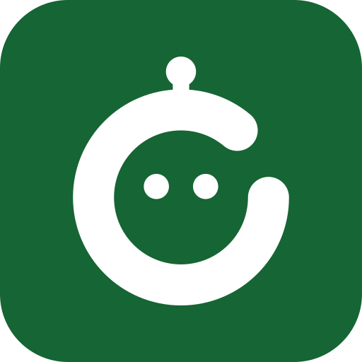
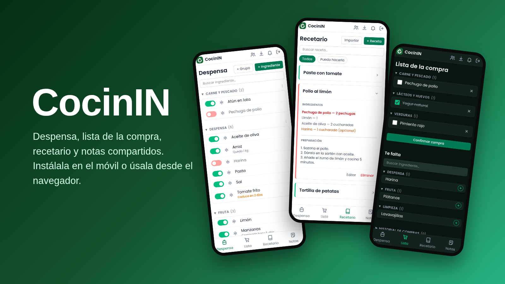
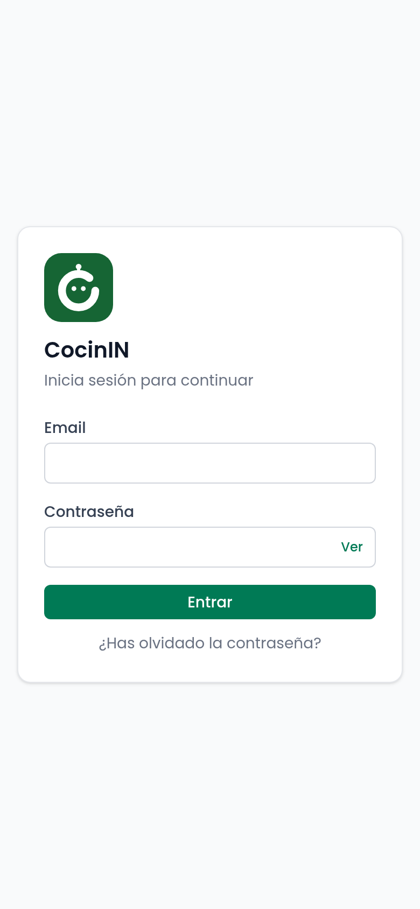
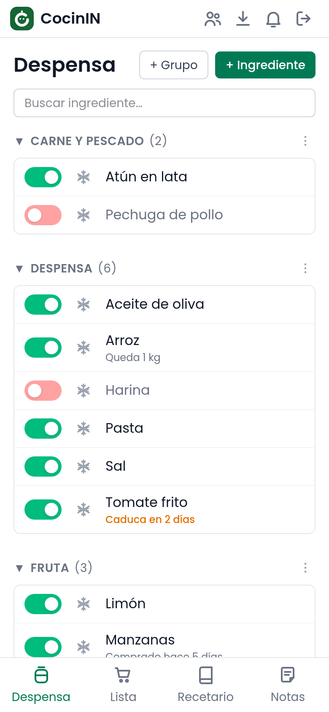
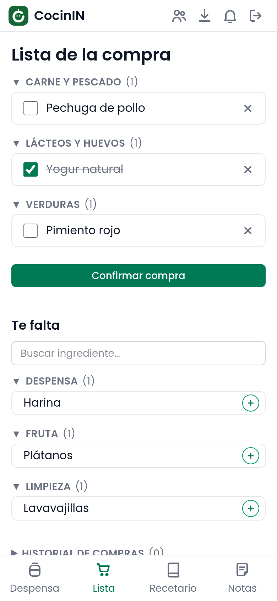
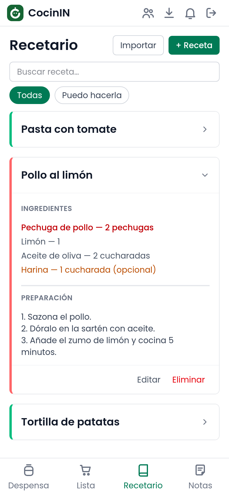
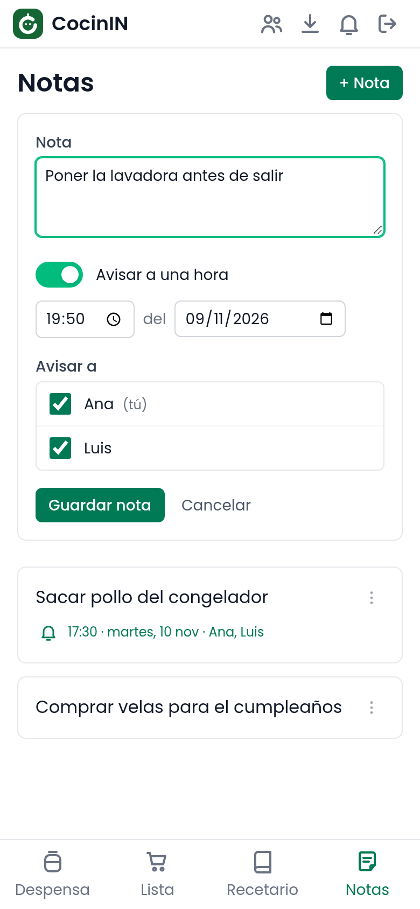

<p align="center">
  
</p>

<h1 align="center">CocinIN</h1>

<p align="center">
  Despensa, lista de la compra, recetario y notas compartidos para toda la casa.<br>
  Se instala como app en el móvil y también funciona desde cualquier navegador.
</p>

<p align="center">
  
</p>

## ¿Qué es?

CocinIN responde a tres preguntas del día a día: **¿qué tenemos en casa?**, **¿qué hay que comprar?** y **¿qué podemos cocinar?** Todo se sincroniza al instante entre las personas de la casa: si alguien tacha algo en el súper, los demás lo ven en su móvil.

- 🥫 **Despensa**: ingredientes por grupos con un interruptor *disponible / agotado*, un copo de nieve para marcarlos como *congelados*, y fecha de compra o de caducidad (con avisos de «caduca en 2 días»).
- 🛒 **Lista de la compra**: lo que te falta, con buscador y un «+» para añadirlo (con «Deshacer»). Al confirmar la compra, lo comprado vuelve a la despensa y se anota en el historial.
- 📖 **Recetario**: recetas con ingredientes (obligatorios u opcionales) y preparación, con buscador y filtro «Puedo hacerla». Lo que te falta sale en rojo (y en ámbar si es opcional).
- 📝 **Notas**: recordatorios con hora y fecha («Sacar pollo del congelador, mañana a las 17:30») que avisan por el móvil a las personas que elijas.
- 👥 **Usuarios**: un administrador da de alta a los demás y puede ponerles un alias. Cada casa tiene su propia instalación y sus datos son privados.
- 📥 **Importar recetas**: pega el JSON que te prepare cualquier IA con la receta y se añaden al recetario, con vista previa.
- 🔔 **Avisos en el móvil** (opcional): algo se ha agotado, compra hecha, algo va a caducar, una nota con hora…
- 🌗 Modo claro y oscuro automático, copia de seguridad en un clic (icono de descarga de la barra superior) y aviso cuando hay una versión nueva de la app.

Es una **PWA**: puedes usarla desde el navegador del ordenador o del móvil, o **instalarla como una app** con su icono en la pantalla de inicio, a pantalla completa y sin barra del navegador.

### Instalarla como app

| Dispositivo | Cómo |
| --- | --- |
| Android (Chrome) | Menú ⋮ → **Instalar aplicación** (o *Añadir a la pantalla de inicio*). |
| iPhone / iPad (Safari) | Botón Compartir → **Añadir a pantalla de inicio**. |
| Ordenador (Chrome, Edge) | Icono de instalar en la barra de direcciones. |

## Capturas

<p>
  
  
  
  
  
</p>

*Los datos de las capturas son de ejemplo.*

Tecnología: React 19 + TypeScript + Vite + Tailwind, y Firebase (Authentication, Firestore y Hosting).

---

## Instalación

Necesitas una **cuenta de Google** (sin tarjeta: plan gratuito de Firebase). Node.js y Git los instala el propio instalador, o tú a mano. Igual en Windows, macOS y Linux.

> ⚠️ **Crea tu usuario nada más desplegar:** el primero que se crea es el administrador y, hasta entonces, cualquiera con la URL podría serlo.

Hay **dos formas** de instalarlo. **Elige una**: con la A no necesitas hacer nada de la B.

#### Opción A · Instalador de un comando (la más fácil)

Abre una terminal (Windows: tecla Windows → **PowerShell**; macOS: Cmd + Espacio → **Terminal**; Linux: **Terminal**), pega la línea de tu sistema y pulsa Enter. Instala Git y Node.js si faltan, descarga CocinIN en la carpeta `cocinin` de tu usuario, instala lo necesario y lanza el asistente de Firebase. Puedes leer el script antes de ejecutarlo: [`instalar.sh`](instalar.sh) · [`instalar.ps1`](instalar.ps1).

| Sistema | Comando |
| --- | --- |
| Windows | `irm https://raw.githubusercontent.com/nithreel/cocinin/main/instalar.ps1 \| iex` |
| macOS / Linux | `curl -fsSL https://raw.githubusercontent.com/nithreel/cocinin/main/instalar.sh \| bash` |

Te pedirá confirmación antes de instalar nada (y, en Linux, tu contraseña para instalar Git). Se detiene en el único paso que no se puede automatizar, **activar el acceso por correo en Firebase**, y te explica cómo. Con esto has terminado: salta a «Ya está instalada…» más abajo.

---

#### Opción B · Paso a paso, a mano

Es lo mismo que hace el instalador, pero tecleando tú cada comando (unos 15 minutos). Tras cada paso hay una **comprobación**; si no sale lo esperado, no sigas y mira [Problemas frecuentes](#problemas-frecuentes).

1. **Instalar Node.js y Git.**
   - Windows (PowerShell): `winget install OpenJS.NodeJS.LTS` y `winget install Git.Git`. Sin `winget`, los instaladores de <https://nodejs.org> y <https://git-scm.com>.
   - macOS: `brew install node git`. Linux: `nodejs` (v20+), `npm` y `git` con el gestor de tu distribución.
   - **Cierra la terminal y ábrela de nuevo**, y comprueba con `node --version` y `git --version`. ✅ `v20.…` o superior y `git version 2.…`.
2. **Descargar CocinIN:** `git clone https://github.com/nithreel/cocinin.git`, `cd cocinin` y `npm install` (uno por uno; `npm install` tarda 1-2 minutos y los `warn` son normales). ✅ Termina con `added … packages`, sin `ERR!`; `ls` (macOS/Linux) o `dir` (Windows) muestra `package.json`.
3. **`npm run setup`.** El asistente comprueba Node, dependencias, Git e internet (`npm run setup -- --comprobar` ejecuta solo eso) y te va preguntando:
   1. Se abre el navegador para iniciar sesión con tu cuenta de Google. Acepta y vuelve a la terminal.
   2. **Id de proyecto:** minúsculas, números y guiones, de 6 a 30 caracteres y empezando por letra (p. ej. `cocinin-maria`). Será tu URL, `https://<id>.web.app`; es único en todo Firebase (si está cogido, pide otro) y público: no pongas nada personal.
   3. Puede pedirte aceptar términos de Google Cloud o de Firebase (solo la primera vez): acepta en la página que se abre y pulsa Enter.
   4. Crea el proyecto, la base de datos y las reglas sin que hagas nada.
   5. **Paso manual (1 minuto):** abre la dirección de Authentication que te muestra, pulsa **Comenzar** y, en *Correo electrónico/contraseña*, **Habilitar** y **Guardar**. Vuelve y pulsa Enter.
   6. Compila y publica la web (1-2 minutos). ✅ Termina con `✔ Listo. Abre https://<tu-id>.web.app …`.

---

#### Ya está instalada

Tanto con la opción A como con la B, la instalación ha terminado cuando tu URL abre CocinIN y has creado tu usuario. Lo demás ([usuarios](#usuarios-y-seguridad), [avisos](#avisos-en-el-móvil-opcional), [instalarla como app](#instalarla-como-app)) es configuración opcional.

**Ten en cuenta** (vale para las dos opciones)
- No hace falta activar facturación: ignora cualquier oferta de pasar al plan Blaze.
- La base de datos se crea en Europa (`eur3`) y la región no se puede cambiar después.
- Una instalación (un proyecto de Firebase) por casa, para no mezclar datos.
- Si `setup` falla a medias, repítelo con el mismo id: reutiliza lo que ya exista.
- El asistente guarda tu sesión de Firebase en tu ordenador: no lo hagas en uno público o compartido. No subas ni compartas `firebase-debug.log` ni, si montas los avisos, `notifier/secrets/`.


<details>
<summary>Instalación manual, sin el asistente</summary>

1. Crea el proyecto en <https://console.firebase.google.com> (su id será tu URL).
2. **Authentication** → activa **Email/Password**. **Firestore Database** → crear en modo producción, región europea.
3. Configuración del proyecto → *Your apps* → icono `</>` para registrar la app web y copiar `firebaseConfig`.
4. `npm install`, copia `.env.example` a `.env` y `.firebaserc.example` a `.firebaserc` (`copy` en Windows, `cp` en macOS/Linux) y rellénalos con esos valores y tu id.
5. `npx firebase login` y `npm run deploy`.
6. Abre `https://<id>.web.app` y crea enseguida el primer usuario.

</details>

---

## Uso diario

| Acción | Cómo |
| --- | --- |
| Añadir ingrediente | Despensa → «+ Ingrediente». Nace disponible (ON). |
| Agotado / disponible / congelado | Interruptor a la izquierda del ingrediente (verde disponible, rojo agotado, azul congelado); el copo de nieve, a su lado, lo marca como congelado (cuenta como disponible). Al agotarlo, la app te ofrece «Añadir a la lista». |
| Caducidad, cantidad, editar o eliminar | Toca el ingrediente: fechas, cantidad (texto libre, p. ej. «500 g») y botones **Editar** y **Eliminar**. |
| Buscar | El buscador de la Despensa filtra por ingrediente **o por grupo**. |
| Comprar | Lista → «+» en lo que falta → marca lo comprado → «Confirmar compra». |
| Receta nueva | Recetario → «+ Receta», o **Importar** para pegar un JSON con una o varias recetas (vista previa y «Deshacer importación»). |
| Nota con aviso | Notas → «+ Nota» → activa «Avisar a una hora», elige hora y fecha y a quién avisar (por defecto, a todos). |
| Usuarios y copia de seguridad | En la barra superior: **Usuarios** (solo administrador: alta, baja y alias) y el icono de **descargar copia de seguridad**, para cualquiera. |
| Olvidé la contraseña | Login → «¿Has olvidado la contraseña?» |

---

## Usuarios y seguridad

- Es **miembro** quien tiene un documento `users/{uid}`; las reglas (`firestore.rules`) solo dejan leer y escribir a los miembros. **Solo el admin** (el primero creado) da de alta o quita acceso a otros.
- «Quitar acceso» bloquea al usuario en la app; su cuenta sigue en Authentication y puede borrarse en la consola.
- La configuración web de Firebase (`VITE_FIREBASE_*`) **no es secreta**: la protección real son las reglas de Firestore. Aun así, `.env` no se sube a git.
- **Un proyecto de Firebase por casa**: no compartas proyecto entre casas distintas, se mezclarían los datos.

---

## Avisos en el móvil (opcional)

La app funciona completa sin esto. Si quieres notificaciones (algo se ha gastado, compra hecha, algo va a caducar…), hace falta un servicio pequeño en una máquina tuya siempre encendida con Docker, por ejemplo una Raspberry Pi. Firebase gratis no puede enviarlas por sí solo.

Avisa de: ingrediente agotado, varios añadidos a la lista, compra hecha, receta nueva, usuario nuevo, caducidad próxima y notas con hora. Cada persona elige cuáles quiere en la campana de la barra superior, y nunca se avisa a quien provoca el cambio.

**Instalación**
1. Descarga la clave de tu proyecto: consola de Firebase → Configuración del proyecto → Cuentas de servicio → *Generar nueva clave privada*, y guárdala como `notifier/secrets/service-account.json` (no la subas ni la compartas).
2. Ejecuta `cd notifier && ./instalar.sh` (en esa máquina) o `./instalar.sh usuario@host` (por ssh). El script hace el resto; si cambia `.env`, ejecuta después `npm run deploy`.
3. En cada móvil: campana de la barra superior → **Activar**. En iPhone, antes añade la app a la pantalla de inicio.

Si la máquina está apagada, los avisos de ese rato se pierden. Más detalles en [`notifier/README.md`](notifier/README.md).

---

## Actualizar y mantener


Cuando haya cambios en este repositorio, tu copia no se actualiza sola. Desde la carpeta `cocinin`, un solo comando:

```sh
npm run actualizar
```

(equivale a `git pull`, `npm install` y `npm run deploy`).

Tu `.env` y `.firebaserc` no se tocan, así que sigues con tu proyecto y tus datos. La app instalada puede enseñar la versión anterior hasta que la cierres y abras una o dos veces (en el navegador, `Ctrl+Shift+R`). Si `git pull` se queja de cambios locales, guárdalos con `git stash`, haz el `pull` y recupéralos con `git stash pop`.

- **Aviso de versión nueva**: el admin ve un aviso en la app cuando hay una release más reciente en GitHub que la instalada (una consulta al día a la API pública de GitHub). Para no consultar: `VITE_DISABLE_UPDATE_CHECK=true` en `.env`; para otro repositorio: `VITE_UPDATE_REPO=usuario/repo`.
- Solo las reglas: `npm run deploy:rules`.
- **Sin conexión**: la app guarda una copia local y sincroniza al volver la cobertura.
- **Copia de seguridad**: descárgala de vez en cuando con el icono de descarga de la barra superior.
- **Dominio propio**: Firebase Console → Hosting → *Add custom domain*.
- Límites del plan gratuito (Spark): 50 000 lecturas y 20 000 escrituras al día en Firestore; de sobra para una casa.

<a id="problemas-frecuentes"></a>
<details>
<summary>Problemas frecuentes</summary>

| Síntoma | Solución |
| --- | --- |
| «Falta la configuración de Firebase» | No hay `.env`: ejecuta `npm run setup` o copia `.env.example` y rellénalo. |
| El login pide activar el acceso por correo | Authentication → Sign-in method → habilita Email/Password. |
| «Las reglas de Firestore no están desplegadas» o 403 | `npm run deploy:rules`. |
| «Tu cuenta no tiene acceso a esta cocina» | Que el admin la dé de alta desde **Usuarios**. |
| El id de proyecto se rechaza | Los ids son únicos en todo Firebase; prueba otro. |
| `firebase: command not found` | Usa `npx firebase …`. |
| `node` o `git` «no se reconoce» / «command not found» | Cierra la terminal y ábrela de nuevo tras instalarlos; si sigue, reinstálalos. |
| `node --version` da menos de v20 | Actualiza Node.js (Paso 1) y vuelve a abrir la terminal. `npm run setup -- --comprobar` lo verifica. |
| `npm install` falla con `EACCES` (Linux/macOS) | No uses `sudo`. Instala Node con un gestor de versiones (`nvm`, `mise`) o arregla los permisos de npm. |
| El navegador no se abre al iniciar sesión (servidor, SSH…) | `npx firebase login --no-localhost`, sigue las instrucciones y repite `npm run setup`. |
| Al terminar, la URL da «Site Not Found» | Espera un minuto y recarga; si sigue, `npm run deploy`. |
| Otro error | Copia el mensaje **completo** de la terminal (y mira `firebase-debug.log` si existe) para buscarlo o para abrir una *issue* en GitHub. |
| Windows: «la ejecución de scripts está deshabilitada» | Una vez: `Set-ExecutionPolicy -Scope CurrentUser RemoteSigned`, o usa cmd. |
| No veo los cambios tras desplegar | Caché de la PWA: cierra y abre la app, o `Ctrl+Shift+R`. |

</details>

---

## Desarrollo

```sh
npm run dev      # servidor local con recarga (usa tu .env, es decir, tus datos reales)
npm run lint     # oxlint
npm run build    # tsc + vite build
npm test         # pruebas unitarias (caducidades, agrupación)
npm run test:rules  # pruebas de las reglas de seguridad (emulador, Java 21+)
```

Cada `push` y cada pull request pasan por GitHub Actions (`.github/workflows/ci.yml`): lint, compilación y las dos baterías de pruebas.

Para desarrollar **sin tocar datos reales** puedes usar los emuladores de Firebase (necesitan Java 21+; en Windows: `winget install EclipseAdoptium.Temurin.21.JDK`):

```sh
npm run emulators                              # Auth :9099 y Firestore :8089, en otra terminal
```

Y en otra terminal, arranca la app apuntando a ellos:

```sh
# macOS / Linux
VITE_USE_EMULATORS=true npm run dev

# Windows (PowerShell)
$env:VITE_USE_EMULATORS="true"; npm run dev
```

Los emuladores empiezan vacíos: en el login aparecerá «Crear usuario» para crear el administrador local.

Estructura:

```
src/auth/            login, sesión y rutas protegidas (roles admin / member)
src/features/        pantry (despensa), shopping-list, recipes, users
src/lib/             tipos y colecciones de Firestore, datos en vivo, caducidades
src/components/      layout y piezas comunes (menús, buscador, borrado con confirmación)
tests/               unit/ (lógica pura) y rules/ (reglas de Firestore con emulador)
scripts/setup.mjs    asistente de instalación (npm run setup)
firestore.rules      reglas de acceso
```

## Licencia

MIT. Ver `LICENSE`.
